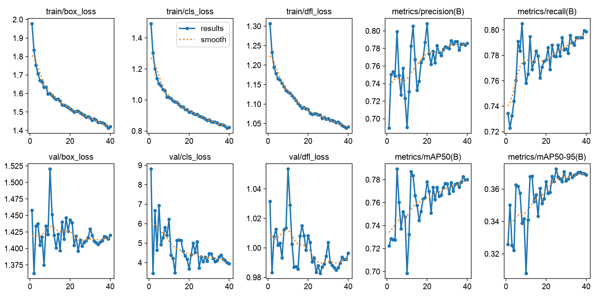
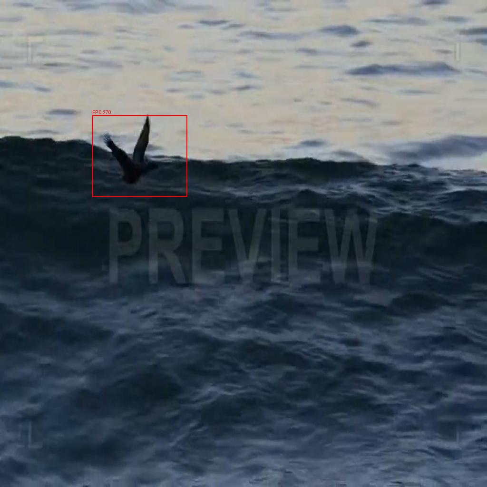
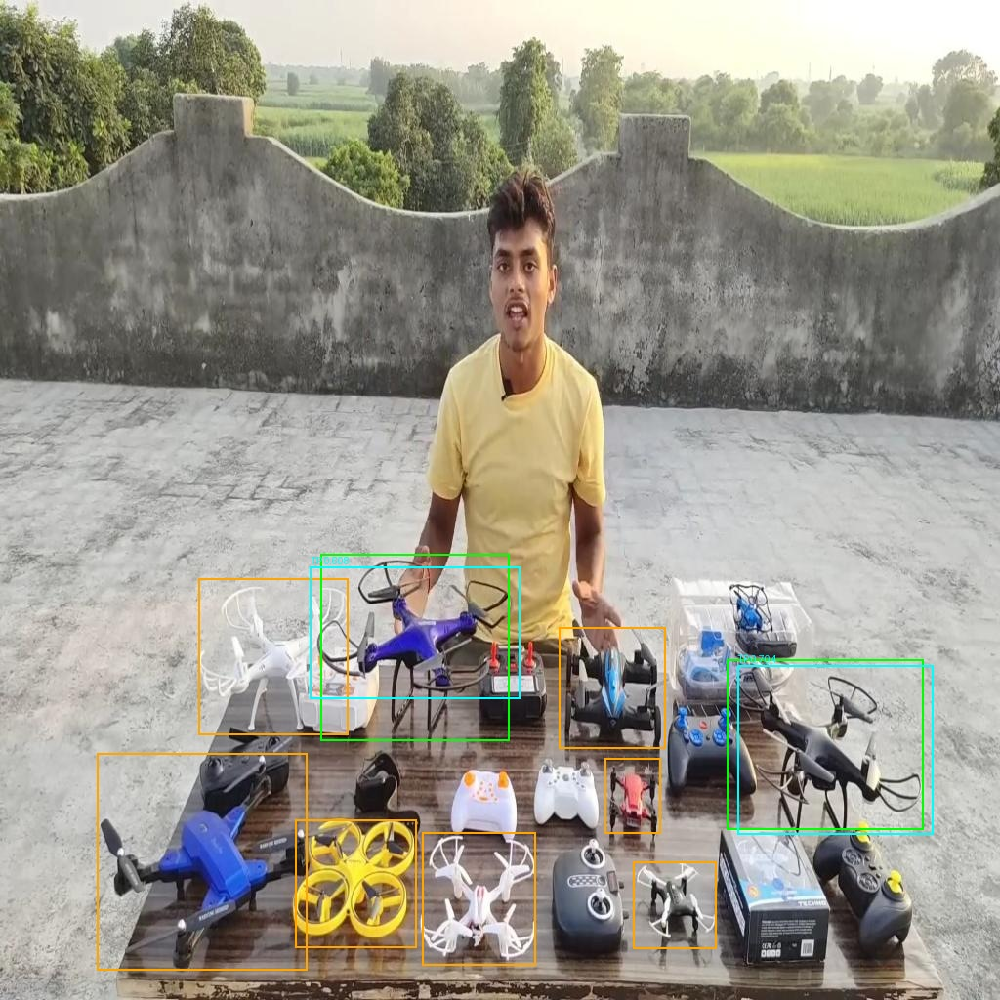
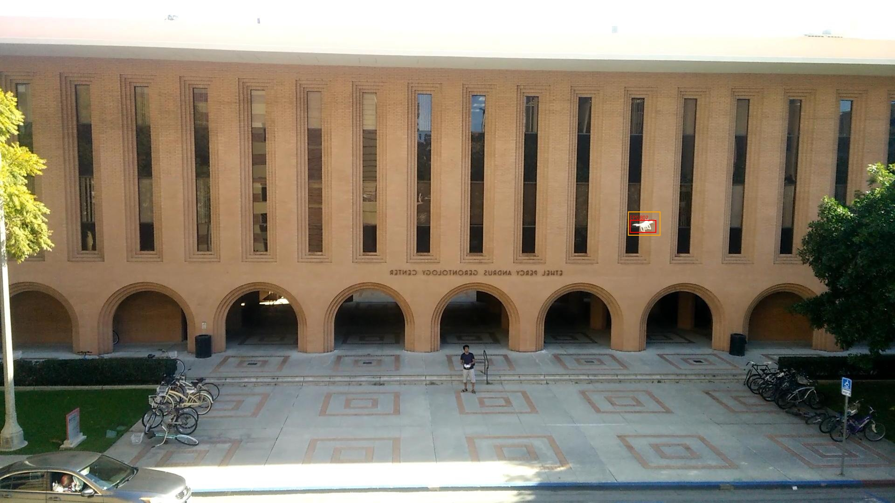
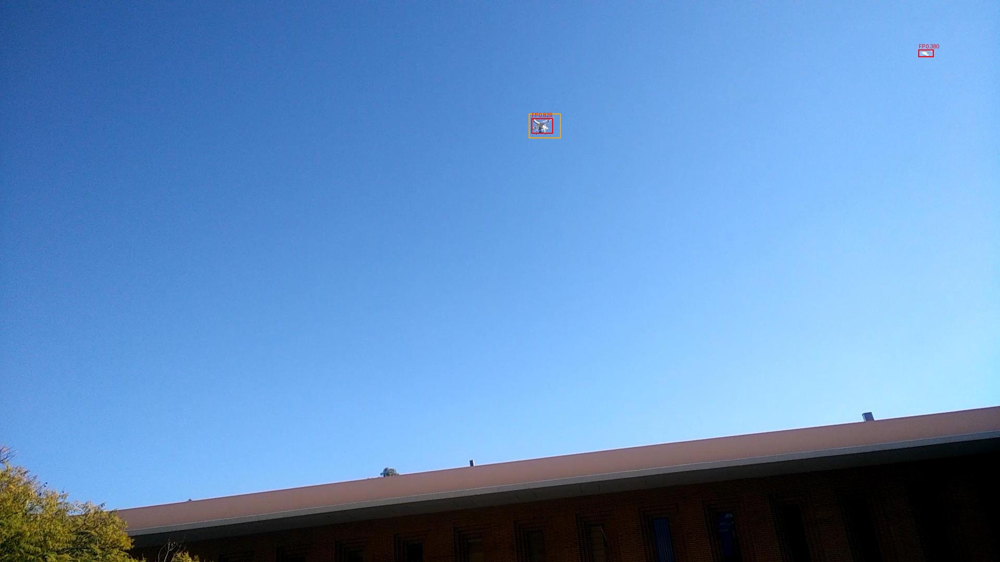

# V1 起点续训结果与误差分析

原计划 60 轮，从第 35 轮续训。第 40 轮按 patience=15 正常早停。最佳权重来自第 25 轮。数据版本 drone_rgb_v3_20261030，单类别 drone。

## 训练结果曲线

训练 loss 持续下降，验证 mAP50–95 在第 25 轮达到峰值 37.24%，随后 15 轮未刷新。验证 loss 有波动，故按原早停规则保留第 25 轮 best.pt。图中数据来自本次 40 轮训练记录。

## 整体指标

| 划分 | 图片 | Precision | Recall | mAP50 | mAP50–95 | TP | FP | FN |
|---|---:|---:|---:|---:|---:|---:|---:|---:|
| val | 1692 | 0.7819 | 0.7767 | 0.7724 | 0.3712 | 798 | 225 | 245 |
| final_test | 528 | 0.9377 | 0.8315 | 0.8611 | 0.4806 | 396 | 38 | 75 |

Precision、Recall 和 AP 来自验证器的置信度扫描。TP、FP、FN 在 conf=0.25、NMS IoU=0.45、匹配 IoU=0.50 下逐框统计，因此不能将这两组数值直接代入同一公式。同一图片可能同时有 FP 和 FN。

## 按数据来源分类

| 划分 | 来源 | 图片 | TP | FP | FN |
|---|---|---:|---:|---:|---:|
| val | AOD-4 | 40 | 2 | 8 | 3 |
| val | Anti-UAV300 | 408 | 337 | 65 | 64 |
| val | Halmstad-new-RGB | 6 | 0 | 0 | 0 |
| val | Zagreb-RGB-2025 | 258 | 157 | 30 | 101 |
| val | halmstad | 980 | 302 | 122 | 77 |
| final_test | AOD-4 | 87 | 17 | 12 | 27 |
| final_test | Anti-UAV300 | 338 | 330 | 4 | 6 |
| final_test | Halmstad-new-RGB | 12 | 0 | 0 | 0 |
| final_test | USC-MCL-RGB | 91 | 49 | 22 | 42 |

最终测试中，USC-MCL-RGB 的 91 张图贡献 42 个 FN、22 个 FP，AOD-4 贡献 27 个 FN、12 个 FP。Anti-UAV300 的 338 张图只有 6 个 FN、4 个 FP。不同来源之间的难度差异显著。

## 按目标尺寸分类

尺寸为 sqrt(框面积) × 640 / max(图宽, 图高)。召回率按真实框尺寸分组，误检框按预测框尺寸分组。

| 划分 | 尺寸 | GT | 已匹配 | FN | Recall | FP |
|---|---|---:|---:|---:|---:|---:|
| val | <20px | 138 | 50 | 88 | 36.2% | 34 |
| val | 20-32px | 413 | 356 | 57 | 86.2% | 91 |
| val | 32-96px | 383 | 317 | 66 | 82.8% | 78 |
| val | >=96px | 109 | 75 | 34 | 68.8% | 22 |
| final_test | <20px | 94 | 49 | 45 | 52.1% | 23 |
| final_test | 20-32px | 160 | 150 | 10 | 93.8% | 2 |
| final_test | 32-96px | 202 | 189 | 13 | 93.6% | 8 |
| final_test | >=96px | 15 | 8 | 7 | 53.3% | 5 |

最终测试中，小于 20px 的 94 个目标漏检 45 个，召回率 52.1%。20–32px 与 32–96px 的召回率分别为 93.8% 和 93.6%。大于等于 96px 的目标仅 15 个，召回率 53.3%，样本较少。

## 例图与错误类型

以下为抽样观察。橙框是真实但未匹配的目标，绿框是已匹配真实目标，青框是已匹配预测，红框是未匹配预测。完整统计见上表，全部带框错误图与逐图 CSV 保存在最终交付目录。

### 鸟类外形误检

AOD-4 水面场景中的飞鸟被预测为无人机，置信度约 0.27，接近 0.25 的统计阈值。

### 同屏多架无人机漏检

AOD-4 的地面展示画面里，多架无人机有不同尺寸、遮挡与朝向。部分检出，部分漏检。

### 框位置不匹配

USC 画面中的预测框靠近真实框，但按 IoU=0.50 的规则仍同时产生 FP 和 FN。这类应与完全没有预测框的漏检分开理解。

### 极小目标与邻近干扰

USC 空中画面的目标很小，存在预测框与真实框偏移，以及远处小亮点被检出。

完整错误图片和逐图记录位于 U 盘最终目录的 current_resume/reports/val_errors 与 current_resume/reports/final_test_errors。独立对照实验按最新要求暂缓。
